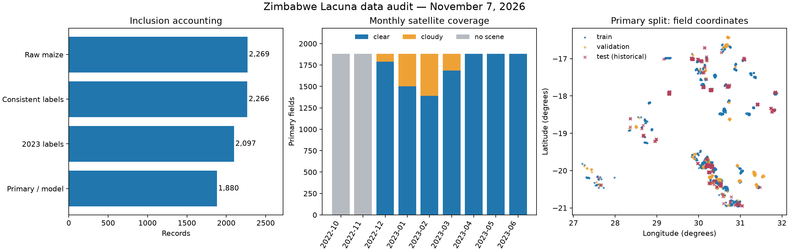

# Zimbabwe Lacuna data audit

Generated by `python scripts/step8_build_zimbabwe_handoff.py`, release `zimbabwe_midterm_v1`.
This is a data audit, not a model evaluation. Every reported count is calculated from the pinned local files.

## Population and inclusion

| Stage | Records | Rule |
|---|---:|---|
| Provider file, all crops | 3,002 | Original GeoJSON |
| Raw maize | 2,269 | Crop_Type = Maize/Corn |
| Consistent maize labels | 2,266 | Reject 3 crop-cut conversion mismatches; preserve originals in row_audit.csv |
| 2023 consistent labels | 2,097 | Keep 169 2022 rows in the label export, outside primary modeling |
| 2023 pure stand | 1,885 | Exclude 212 intercropped records |
| 2023 pure stand, rainfed | 1,880 | Exclude 5 irrigated records |
| Model table | 1,880 | At least 4 observed months, all 10 seasonal features finite |

Exclusion counts above are sequential, not overlapping flag totals. All 28 primary zero yields stay.
The filename contains 2022–2023; the delivered primary model population is 2023 only.

## Checks completed

- Provider MD5, frozen labels SHA-256, both split SHA-256 values and complete team database SHA-256 match their manifests.
- Raw IDs, source-row numbers, coordinates (both longitude and latitude), yield, dates, management and normalized Admin1 agree with frozen labels.
- Independently reconstructed screening and primary inclusion match the frozen IDs and flags.
- Label IDs and database IDs are unique. Observation-month keys are unique; each observation has nine ordered season months.
- Database yields and inclusion flags match the label file; observed-month counts match the monthly table.
- Missing months contain missing reflectance, rather than fabricated zeros. Observed reflectance and model features are finite.
- Split membership covers every primary observation exactly once, and keeps each splitting group whole.
- No pair within 10 m crosses partitions. Primary split train/validation/test pairs are separated by at least 2 km.

## Yield and source limitations

The source column `Yield(Mt/H` is interpreted as metric tonnes/ha, multiplied by 1,000 once to obtain kg/ha.
For a 40 m² cut, dry kg × 10,000 / 40 / 1,000 = dry kg × 0.25 t/ha. The 3 rejected rows
instead have dry kg × 0.5. Their true cut area is unknown, so no automatic correction is made.
The metadata says “Megatonnes”; the provider Python manual describes Mg/ha, consistent with the numeric identity.
`unit_provisional=true` remains in the frozen labels. Moisture percentage and grain-versus-cob basis remain unverified.
Dry weight, wet weight, reported yield and crop-condition labels are audit fields, never satellite-model predictors.

## Spatial and temporal quality

- Primary rows with exactly reused coordinates: **14**. Proximity alone does not prove duplicate farms.
- Primary rows with another primary row within 10 m: **16**. They stay grouped, with their original yields.
- Legacy near_dup_10m flags can also refer to excluded rows; use the population-specific flag in row_audit.csv for this count.
- Primary records with harvest dates outside the fixed Oct–Jun window: **2**.
- Raw records with absent or nonpositive growing duration: **0**.
- Admin1 has **20** values among primary rows, but mixes administrative levels; call these Admin1 groups, not verified districts.
- Location screening uses a bounding box, not a national boundary polygon or field-boundary verification. GPS accuracy is undocumented.
- Observed scenes after the recorded harvest: **3,934**, affecting **1,810/1,880** primary fields.
  Full-season features are retrospective yield-estimation inputs. A forecasting experiment needs a declared prediction date and separately built features
  restricted to information available by that date; filtering by the future actual harvest date is not a deployable forecasting rule.
- October and November 2022 have no accepted scenes in this pinned extraction. Do not describe missing months as crop absence.
- 2022 has limited imagery (see audit_summary.json); the existing policy excludes it. This is not proof that imagery is unavailable from every archive.

## Explicit partitions

Existing fold 0 → test; fold 1 → validation; folds 2–4 → train. No frozen assignment is changed.

| Family | Train | Validation | Test | Minimum across partition pairs (km) |
|---|---:|---:|---:|---:|
| s1_cc2km | 1128 | 376 | 376 | 2.011 |
| s2_region | 1127 | 375 | 378 | 1.668 |

`s1_cc2km` is the primary new-location comparison. `s2_region` is the Admin1 holdout sensitivity analysis; it does not promise 2 km separation.
Fit clipping, imputation, scaling and hyperparameters on training data only. Use grouped internal CV or the validation partition for tuning.
Monthly rows inherit their field's partition; never randomly split observation-month rows.

**Evaluation history:** test is a historical, previously evaluated partition, not an untouched prospective holdout.
The November 1 decision permits no new model arm to score fold 0 in any family. This release preserves that restriction and trains no models.
New models can develop on training/validation data; a genuinely fresh confirmation needs new unexamined observations or an explicitly revised protocol.

## Reproducibility and handoff

`manifest.json` records config, package versions, code/input hashes, output hashes and the repository commit.
The builder uses a read-only database connection, stages outputs in a temporary directory, and refuses to replace an existing non-identical release.
Rebuild with the same inputs to verify byte-identical outputs. Choose a new output directory for a revised release.
See [the handoff guide](README.md) for the code map, dictionary, usage and methodological limitations.
`label_summary.csv` gives descriptive yield statistics by harvest year and inclusion status;
`feature_quality.csv` lists finite/missing counts and numerical ranges without removing outliers or fitting transforms.

Sources: [PULA / Lacuna release](https://doi.org/10.5281/zenodo.10060610), its local GeoJSON and Python manual;
`docs/DECISIONS.md`; `docs/EVALUATION.md`; [grouped evaluation guidance](https://scikit-learn.org/stable/modules/cross_validation.html#cross-validation-iterators-for-grouped-data).
