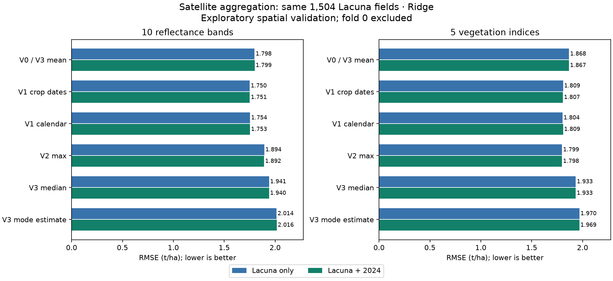

# Satellite aggregation V0–V3: results

All models use Ridge and the same 1,504 Lacuna 2023 development fields. Lower RMSE is better. Fold 0 was neither fit nor scored. Results are exploratory, not a new blind test.

Primary contrast (10 bands, crop-date preharvest mean minus full-season mean, Lacuna only): **-0.0481 t/ha**, 95% spatial-group interval **[-0.0885, -0.0104]**.

| Aggregation | Bands: Lacuna | Bands: merged | Indices: Lacuna | Indices: merged |
|---|---:|---:|---:|---:|
| v0_mean | 1.7984 | 1.7985 | 1.8676 | 1.8668 |
| v1_preharvest_mean | 1.7503 | 1.7511 | 1.8087 | 1.8071 |
| v1_calendar_mean | 1.7540 | 1.7530 | 1.8037 | 1.8086 |
| v2_max | 1.8945 | 1.8916 | 1.7986 | 1.7981 |
| v3_median | 1.9407 | 1.9403 | 1.9332 | 1.9329 |
| v3_mode | 2.0143 | 2.0161 | 1.9698 | 1.9692 |

V0 and V3 mean are identical, so fitted once. V3 median and mode are separate models, not concatenated features.
The historical index mean+max control reproduced its original selected models; saved control predictions are unchanged:

- Lacuna only: **1.7968** t/ha.
- Adaptive merged: **1.7938** t/ha.

## What changed

Bands are monthly field-pixel median reflectances; indices are derived from those values. These models change temporal aggregation only. The two feature families are evaluated separately to avoid confusing a band/index change with a statistic change.

V1 uses recorded planting <= actual image acquisition < recorded harvest for Lacuna, within December–June. 2024 has neither date and uses December–March as a calendar proxy. The additional common-calendar arm applies December–March to both sources.

All evaluation fields remain included. Crop-date V1 has 421 evaluation fields with fewer than four observations; 0 have no observations. A new four-month filter would change the population. The fixed calendar arm includes on/after-harvest scenes for 65 evaluation fields.

The seasonal mode is a half-sample **modal estimate** with averaged tie branches. Exact modes are usually tied because observations are continuous. With only 1–7 months, this estimate can be unstable; it is not a well-established population mode.

## Evaluation and interpretation

All outer/inner memberships and 2 km auxiliary exclusions are copied from the original comparison. Imputation, clipping, scaling, yield calibration and tuning use training observations only. Source ratios include zero; selected_parameters.csv shows whether each merged fit actually used 2024.

Actual crop dates are retrospective metadata. This design does not establish forecast skill, and mixing known crop dates with a calendar proxy does not remove the source mismatch. The common-calendar arm helps expose that difference. Maxima can be sensitive to extremes; the mode estimator can be noisy with few months.

Intervals resample spatial groups and condition on the saved predictions. There are many unadjusted secondary comparisons; the best observed score is descriptive and requires independent validation. No window or grid was retuned after scoring.

## Files and provenance

- `observations.csv`: source/season, outcomes, original eligibility and frozen fold IDs, with crop dates.
- `monthly_observations.parquet`: December–June values and actual image acquisition dates.
- `features.parquet` / `feature_dictionary.json`: all variant predictors, with an explicit column allowlist for each model.
- `window_audit.csv`, `data_summary.json`: crop-date availability, observation counts, mode ties and cutoff diagnostics.
- `target_memberships.csv`, `source_spatial_permissions.csv`: unchanged fit/evaluation permissions.
- `predictions.csv`, `metrics.csv`, `fold_metrics.csv`, `paired_differences.csv`: all 26 model arms and paired uncertainty.
- `tuning.csv`, `selected_parameters.csv`, `training_outer_diagnostics.csv`: training choices and fit gaps.
- `PROTOCOL.md`, `manifest.json`: fixed design, source links, input/output hashes and software versions.

Calendar sources: [FEWS NET p. 4](https://fews.net/sites/default/files/documents/reports/ZW_February_to_September_2023_FSO_Final_jh.pdf) for the typical maize cycle; [Zimbabwe NAP 2024, section 2.1](https://unfccc.int/sites/default/files/resource/NAP-Zimbabwe-2024.pdf) for climatic seasons. Neither supplies the missing 2024 field-level crop dates.
