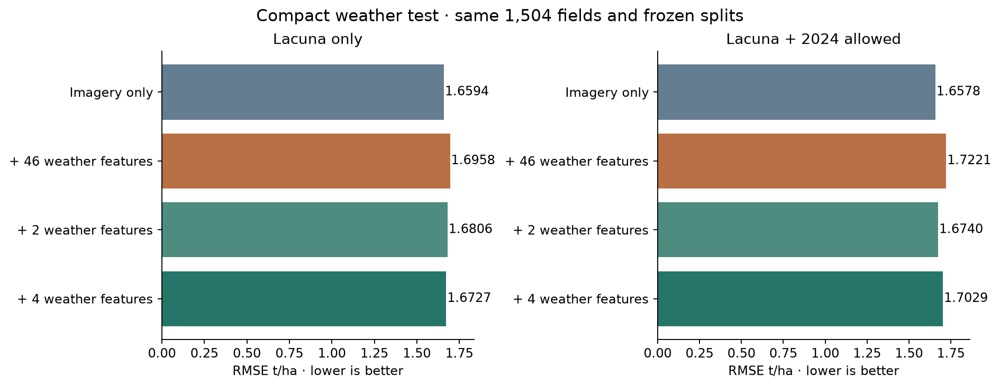

# Compact weather results

Same 1,504 evaluation fields; exploratory. Lower RMSE is better.

| Method | RMSE t/ha | MAE t/ha | R² |
|---|---:|---:|---:|
| monthly_target | 1.692594 | 1.322254 | 0.272339 |
| monthly_adaptive | 1.689178 | 1.318411 | 0.275274 |
| monthly_tree_target | 1.659352 | 1.289692 | 0.300640 |
| monthly_tree_transfer | 1.657757 | 1.296637 | 0.301984 |
| weather_target | 1.744311 | 1.364891 | 0.227192 |
| weather_adaptive | 1.742200 | 1.362420 | 0.229062 |
| weather_shared | 1.749902 | 1.369871 | 0.222230 |
| weather_tree_target | 1.695751 | 1.311391 | 0.269622 |
| weather_tree_transfer | 1.722124 | 1.337624 | 0.246728 |
| compact2_target | 1.699398 | 1.330826 | 0.266477 |
| compact2_adaptive | 1.696023 | 1.327297 | 0.269388 |
| compact2_shared | 1.678338 | 1.302088 | 0.284545 |
| compact2_tree_target | 1.680642 | 1.311757 | 0.282579 |
| compact2_tree_transfer | 1.674022 | 1.308794 | 0.288220 |
| compact4_target | 1.728332 | 1.355323 | 0.241287 |
| compact4_adaptive | 1.724834 | 1.351755 | 0.244355 |
| compact4_shared | 1.655411 | 1.285954 | 0.303959 |
| compact4_tree_target | 1.672713 | 1.296116 | 0.289333 |
| compact4_tree_transfer | 1.702885 | 1.321024 | 0.263464 |

Primary compact4 merging difference +0.030172; 95% group interval [-0.000935, +0.061152].

See paired_differences.csv for all contrasts and the weather-cell bootstrap sensitivity, and training_outer_diagnostics.csv for fit gaps.

