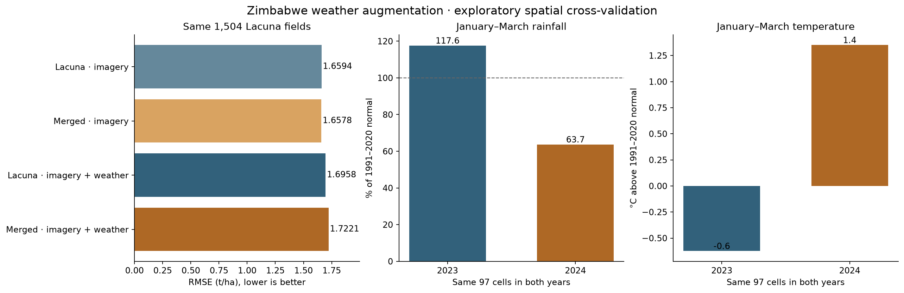

# Zimbabwe weather experiment

Exploratory results; every arm predicts the same 1,504 Lacuna 2023 fields. Fold 0 remains reserved. RMSE/MAE/bias are t/ha. No-weather predictions are unchanged saved controls.

| Method | RMSE | MAE | Bias | R² |
|---|---:|---:|---:|---:|
| monthly_target | 1.692594 | 1.322254 | +0.004525 | 0.272339 |
| monthly_adaptive | 1.689178 | 1.318411 | +0.005403 | 0.275274 |
| monthly_tree_target | 1.659352 | 1.289692 | -0.005360 | 0.300640 |
| monthly_tree_transfer | 1.657757 | 1.296637 | -0.054545 | 0.301984 |
| weather_only_target | 1.905502 | 1.512309 | -0.056175 | 0.077764 |
| weather_target | 1.744311 | 1.364891 | -0.032396 | 0.227192 |
| weather_adaptive | 1.742200 | 1.362420 | -0.035571 | 0.229062 |
| weather_shared | 1.749902 | 1.369871 | -0.032797 | 0.222230 |
| interactions_target | 1.733092 | 1.351325 | -0.014426 | 0.237101 |
| interactions_adaptive | 1.729714 | 1.347903 | -0.018609 | 0.240073 |
| interactions_shared | 1.745263 | 1.359906 | -0.014136 | 0.226349 |
| weather_tree_target | 1.695751 | 1.311391 | -0.058559 | 0.269622 |
| weather_tree_transfer | 1.722124 | 1.337624 | -0.072444 | 0.246728 |

Primary: merged weather minus Lacuna-only weather RMSE = +0.026372; 95% spatial-group bootstrap interval [+0.009351, +0.045004].

Weather × merging interaction = +0.027967; 95% interval [+0.002504, +0.057896]. Negative means weather increased the merging benefit.

## Selected source contributions

| Method | Fold | Source/target weight ratio | Source rows used |
|---|---:|---:|---:|
| weather_only_target | 1 | 0 | 0 |
| weather_target | 1 | 0 | 0 |
| weather_adaptive | 1 | 0.1 | 4226 |
| weather_shared | 1 | 0.3 | 4226 |
| interactions_target | 1 | 0 | 0 |
| interactions_adaptive | 1 | 0.1 | 4226 |
| interactions_shared | 1 | 0.3 | 4226 |
| weather_tree_target | 1 | 0 | 0 |
| weather_tree_transfer | 1 | 1 | 4226 |
| weather_only_target | 2 | 0 | 0 |
| weather_target | 2 | 0 | 0 |
| weather_adaptive | 2 | 1 | 4191 |
| weather_shared | 2 | 1 | 4191 |
| interactions_target | 2 | 0 | 0 |
| interactions_adaptive | 2 | 1 | 4191 |
| interactions_shared | 2 | 1 | 4191 |
| weather_tree_target | 2 | 0 | 0 |
| weather_tree_transfer | 2 | 0.1 | 4191 |
| weather_only_target | 3 | 0 | 0 |
| weather_target | 3 | 0 | 0 |
| weather_adaptive | 3 | 1 | 4194 |
| weather_shared | 3 | 0 | 0 |
| interactions_target | 3 | 0 | 0 |
| interactions_adaptive | 3 | 1 | 4194 |
| interactions_shared | 3 | 0 | 0 |
| weather_tree_target | 3 | 0 | 0 |
| weather_tree_transfer | 3 | 0 | 0 |
| weather_only_target | 4 | 0 | 0 |
| weather_target | 4 | 0 | 0 |
| weather_adaptive | 4 | 1 | 4213 |
| weather_shared | 4 | 0.3 | 4213 |
| interactions_target | 4 | 0 | 0 |
| interactions_adaptive | 4 | 1 | 4213 |
| interactions_shared | 4 | 0.3 | 4213 |
| weather_tree_target | 4 | 0 | 0 |
| weather_tree_transfer | 4 | 0 | 0 |

Weather-cell overlap: 1447/1504 evaluation fields share a weather cell with target-training fields. The required 2 km splits do not test entirely new weather cells.

## Weather contrast on the same 97 cells

| Harvest year | Jan–Mar rainfall % normal | Jan–Mar temperature anomaly °C |
|---|---:|---:|
| 2023 | 117.615 | -0.624 |
| 2024 | 63.703 | 1.350 |

The weather contrast is descriptive, not causal attribution of yield differences. Year, provider, management, and measurement protocol remain confounded. Monthly regional weather cannot establish field drought damage or dry-spell duration.

Run step11 with the cached NASA responses, then step12. PROTOCOL.md describes source matching, unit conversion, baseline construction, training-only preprocessing and all parameter grids. The full input/output hash chain is in manifest.json.

