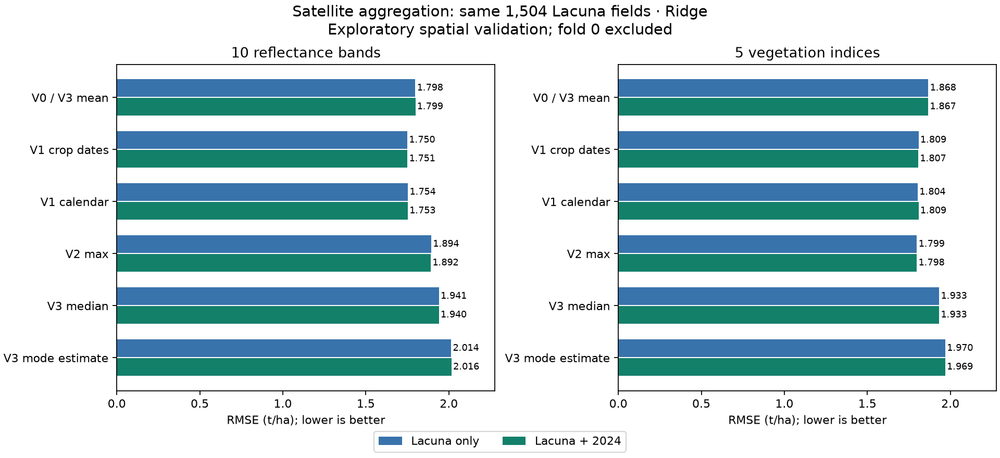

# Satellite aggregation: preharvest means helped the compact band model

For exact R² values, the calculation and a copyable external-review request, see the [R² audit](R2_AUDIT.md). For the later expanded training pools on these same evaluation fields, see [step 15](MULTIYEAR_RESULTS.md).

**V1 improved the mean-only reflectance-band baseline, while median and mode were worse.** On the same 1,504 Lacuna
fields, target-only Ridge RMSE fell from **1.7984 to 1.7503 t/ha** (2.68%). The paired difference was **−0.0481**, with
95% spatial-group interval **[−0.0885, −0.0104]**. Adding 2024 still provided no clear gain.

This is an improvement within the simple aggregation experiment. It does **not** beat the earlier richer monthly
Ridge baseline (1.6926), and its apparent advantage over the old index mean+max model (1.7968) is uncertain:
paired interval **[−0.1163, +0.0281]**. All results reuse development folds and remain exploratory.

## Versions and results

RMSE in t/ha; lower is better. All models use Ridge, with separately tuned adaptive Ridge for merged training.

| Version | What is summarized | 10 bands: Lacuna | 10 bands: merged | 5 indices: Lacuna | 5 indices: merged |
|---|---|---:|---:|---:|---:|
| V0 / V3 mean | Mean of observed December–June values | 1.7984 | 1.7986 | 1.8676 | 1.8668 |
| V1 preharvest mean | Recorded planting-to-before-harvest window; calendar fallback for 2024 | **1.7503** | **1.7511** | 1.8087 | 1.8071 |
| V1 calendar control | December–March for both sources | 1.7540 | 1.7530 | 1.8037 | 1.8086 |
| V2 max | Maximum over observed December–June values | 1.8945 | 1.8916 | **1.7986** | **1.7981** |
| V3 median | Median over observed December–June values | 1.9407 | 1.9403 | 1.9332 | 1.9328 |
| V3 modal estimate | Half-sample mode over observed December–June values | 2.0143 | 2.0161 | 1.9698 | 1.9692 |

Mean, median and mode are **separate models**, not concatenated predictors. V3 mean equals V0, so it is fitted once.
The earlier baseline already combined index means and maxima; its original 1.7968 / 1.7938 predictions were reproduced
and retained as separate controls. The new study has 24 aggregation models plus those two controls.



## What the season information changed

- Monthly band values are already **spatial medians of clear field pixels from one selected scene**. This experiment
  changes the aggregation **over months**. The ten reflectance bands and five vegetation indices are tested separately.
- Both sources use the common **December–June** imagery range. October/November 2022 images are absent for Lacuna;
  including those extra months only for 2024 would make the comparison unequal.
- For Lacuna V1, an image must satisfy **planting date ≤ actual acquisition date < harvest date**. We use the scene's
  acquisition day, not just its month label. The planting lower bound removes preplanting observations for 130 evaluation fields.
- All 4,332 source labels lack planting/harvest dates. Their V1 is therefore a flagged **December–March proxy**, not
  reconstructed field dates. The same-calendar control applies that window to both sources.
- The actual crop-date and common-calendar band models are close: **1.7503 versus 1.7540**, difference **−0.0037**,
  interval **[−0.0456, +0.0313]**. These data do not establish that exact field dates improve on the shared calendar cutoff.

The [FEWS NET report, p. 4](https://fews.net/sites/default/files/documents/reports/ZW_February_to_September_2023_FSO_Final_jh.pdf)
provides a typical maize calendar with main harvest approximately April–June. The four climatic seasons come from the
[Zimbabwe government National Adaptation Plan 2024, section 2.1](https://unfccc.int/sites/default/files/resource/NAP-Zimbabwe-2024.pdf).
Climatic phases are not individual harvest dates. The fixed cutoff still includes on/after-harvest scenes for **65**
evaluation fields; V1 crop dates remove those. FEWS NET itself is not a Zimbabwe-government field-harvest dataset.

## What can be concluded

**For compact band inputs, restricting the time window helped.** Target-only MAE also fell, from 1.4317 to 1.3912 t/ha,
and R² rose from 0.1785 to 0.2219. The shared calendar's similar result suggests a practical candidate when crop dates
are unavailable; the experiment does not identify the causal reason for the gain.

**Maximum depends on the variable.** It helped vegetation indices relative to their mean-only version but worsened
raw reflectance-band models. Maximum brightness in each band is not equivalent to maximum vegetation condition.
The maxima of different bands can also come from different dates.

**Median and mode are not automatically better.** Exact values almost never repeat, so taking the first exact mode
would usually select the minimum. We used a [half-sample modal estimator](https://arxiv.org/abs/math/0505419), averaging
estimates from tied shortest intervals. With only 1–7 observations it can be unstable. It performed poorly here;
that does not establish that every mode estimator is unsuitable.

**The merge remains a separate question.** Preharvest band RMSE was 1.7503 without 2024 and 1.7511 with it: difference
+0.0008, interval [−0.0013, +0.0027]. Inner validation chose source weight zero in one outer fold. Keep the harmonized
source available, but do not claim that the season adjustment unlocked a material transfer benefit.

## Fair comparison and files

Every arm keeps the same 1,504 evaluation IDs, the same four outer/three inner spatial folds and the existing 2 km source
permissions. Fold 0 is excluded. **421 fields have fewer than four crop-window observations**, but none has zero;
no target field is dropped and no aggregate feature is missing in the eligible comparison population. Training-only
imputation remains implemented for reproducibility on missing inputs. Counts and dates are audited, not model predictors.

These are retrospective crop-date windows, not a demonstrated forecasting system. Many secondary comparisons were
made; their intervals are unadjusted and conditional on the predictions. Preserve the richer monthly model as the
stronger existing benchmark and retain V1 as a compact candidate for independent validation.

- [Complete results](../../data/runs/zimbabwe_aggregation_v1/RESULTS.md), [metrics](../../data/runs/zimbabwe_aggregation_v1/metrics.csv), [paired intervals](../../data/runs/zimbabwe_aggregation_v1/paired_differences.csv).
- [Feature matrix](../../data/runs/zimbabwe_aggregation_v1/features.parquet), [feature dictionary](../../data/runs/zimbabwe_aggregation_v1/feature_dictionary.json), [date/window audit](../../data/runs/zimbabwe_aggregation_v1/window_audit.csv).
- [Fixed protocol](AGGREGATION_PROTOCOL.md), [configuration](../../configs/zimbabwe_aggregation_v1.json), [step 14](../../scripts/step14_compare_zimbabwe_aggregation.py).

Run from the repository root with the pinned team database:

```bash
python scripts/step14_compare_zimbabwe_aggregation.py --output data/runs/zimbabwe_aggregation_replay
python scripts/verify_zimbabwe_aggregation.py
```

Choose a new `--output` destination for each replay; the manifest also records the checkout revision. Earlier releases remain unchanged.

Independent reconstruction and metric/interval checks are recorded in [the verification receipt](../../results/aggregation/verification.json).
