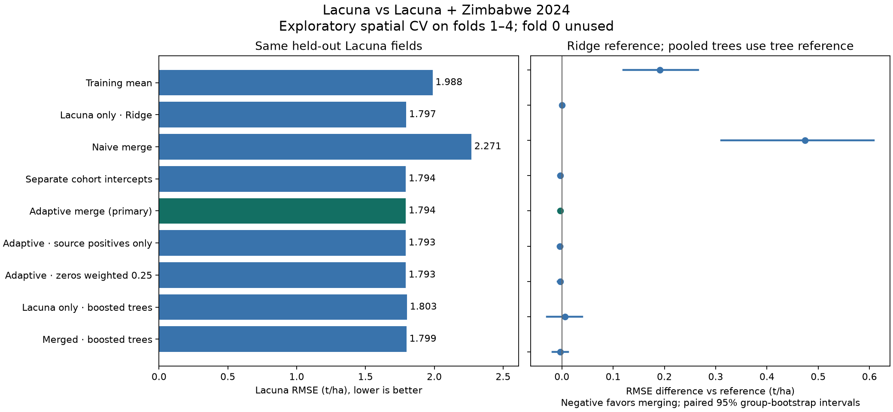

# Zimbabwe merge: what changed, what worked, and what to defend

The two releases are now harmonized in a **6,598-row screened label catalog**. We ran nine model arms on the same
held-out Lacuna observations. Simple pooling damages accuracy. Source-aware modeling removes most of that damage,
but adding 2024 has **not demonstrated a meaningful accuracy improvement** over Lacuna alone.

This is an experiment about auxiliary training data, not a claim that every physical measurement ambiguity is solved.
The complete 19-item problem/action/remaining-limitation register is in
[`ZIMBABWE_MERGE_PROTOCOL.md`](../ZIMBABWE_MERGE_PROTOCOL.md). It was specified before the run.

## The actual comparison

All arms predict the same **1,504 Lacuna 2023 fields**, with four outer spatial folds and three inner folds for tuning.
Each outer fit uses 1,128 target training observations. The 376 historical fold-0 observations are excluded from all
fits and scores. No new blind-test claim is made. Evaluation is retrospective: 2024 labels would not have existed
for a real-time 2023 forecast.

| Training method | RMSE, t/ha ↓ | MAE, t/ha ↓ | R² | Interpretation |
|---|---:|---:|---:|---|
| Target training mean | 1.9881 | 1.6217 | −0.0039 | Reference with no imagery |
| Lacuna only, Ridge | 1.7968 | 1.4477 | 0.1800 | Primary reference |
| Lacuna + 2024, naive Ridge | 2.2707 | 1.7243 | −0.3096 | Pooling all rows equally is harmful |
| Merge with separate source intercepts | 1.7938 | 1.4478 | 0.1827 | Most of the pooling damage disappears |
| Adaptive merge, primary | 1.7938 | 1.4460 | 0.1827 | Small, uncertain improvement |
| Adaptive, source positives only | 1.7932 | 1.4457 | 0.1833 | Sensitivity, not evidence that zeros are invalid |
| Adaptive, zeros weighted 0.25 | 1.7934 | 1.4458 | 0.1831 | Similar conclusion |
| Lacuna only, boosted trees | 1.8026 | 1.4413 | 0.1747 | Second learner |
| Merge, boosted trees with source indicator | 1.7992 | 1.4363 | 0.1778 | Also a small, uncertain improvement |

The primary adaptive-minus-baseline RMSE difference is **−0.00295 t/ha**, about **0.16%**.
The paired 95% spatial-group bootstrap interval is **[−0.00757, +0.00132] t/ha**, crossing zero.
Adaptive pooling improves three outer folds and slightly worsens one. Trees show the same overall conclusion:
ΔRMSE −0.00333 t/ha, interval [−0.01805, +0.01185]. These intervals condition on the saved predictions; they do not
capture every source of training/model-selection or cross-year uncertainty. Secondary comparisons are exploratory.

Naive pooling underpredicts Lacuna by **1.3818 t/ha on average**, while the adaptive model's bias is −0.0206 t/ha.
This is strong evidence that treating both sources as one interchangeable label population is inappropriate for
this task. The experiment does not identify whether the source difference comes from drought, management,
sampling, measurement, or their combination.



## How the merge works

This is a **row-wise union**, not a join asserting that two records belong to the same farm. Source-prefixed
observation IDs, original source row/ID, year, cut protocol, management metadata and eligibility remain attached.
Unknown values remain unknown. We do not average a 2023 observation together with a nearby 2024 observation.

1. Independently reconcile Lacuna against the provider GeoJSON and frozen labels. Retain 2,266 screened records;
   preserve the exclusion of three internally inconsistent dry-weight/yield conversions. The raw audit remains in
   `data/processed/zimbabwe_midterm_v1/row_audit.csv`.
2. Audit all **5,055** raw Zimbabwe 2024 maize records. Exclude **723 missing labels**; retain **4,332 valid labels**,
   including **1,874 recorded zeros**. There are **42 documented single-box records**; missing unused boxes are not zero.
3. Verify the per-box arithmetic, independently average available boxes, and compare it with the reported field label.
   All 4,332 pass. A 40 m² cut gives `t/ha = dry_kg / 40 × 10,000 / 1,000 = dry_kg × 0.25`.
   For example, an 8 kg cut gives 2 t/ha. Two cuts weighing 8 kg and 4 kg give `(2 + 1) / 2 = 1.5 t/ha`.
   An already averaged t/ha yield needs no further division by two or cut-area adjustment.
4. Export all 6,598 labels. For this comparison, use the existing **1,880 pure-stand rainfed Lacuna 2023 fields** as
   the target population. Keep 2022 and other Lacuna management groups in the full catalog, outside this comparison.
   This ensures adding 2024 is the change being tested; it does not silently change the target population.
5. Rebuild both sources' ten spectral statistics from **December–June** only. All target fields pass; two source
   fields fail the four-observed-month minimum, leaving **4,330** source candidates. Missing months stay missing.
6. Remove source points within 2 km of reserved/evaluation target fields. Repeat this protection for inner validation.
   Outer fits admit **4,191–4,226** auxiliary records. Export the exact memberships and all 69,280 source permission
   records so others can verify which observations were allowed in each fit.
7. Fit feature clipping/scaling and cohort calibration using training observations only. Choose source weight and
   regularization using inner target validation. Outer evaluation labels never set a cohort mean, scale or tuning choice.

## Are the seasons the same?

The agricultural-season alignment is the same convention, but the observations are from different years:

| Release/year | Conventional season | Common imagery window used here | Role |
|---|---|---|---|
| Lacuna harvest 2022 | 2021/22 | Not used in this model comparison | Retained in full catalog |
| Lacuna harvest 2023 | 2022/23 | December 2022–June 2023 | Target training/evaluation |
| Zimbabwe collection 2024 | 2023/24 | December 2023–June 2024 | Auxiliary training |

Lacuna has planting/harvest dates. The 2024 release does not, so its season label is inferred from the collection
year and existing project window, not individually verified crop dates. Matching calendar months reduces a known
coverage asymmetry; it does not prove identical crop development stages or weather. Post-harvest imagery is allowed
because this is full-season retrospective estimation. Forecasting needs a separately defined information cutoff.

## What the compatibility methods do—and cannot do

The naive model assumes one relationship and one yield level across both releases. Separate intercepts allow
different average levels. The primary adaptive model also standardizes training yields within each source and learns
both shared and source-specific feature relationships, then converts predictions back to the Lacuna training scale.
Total auxiliary weight is selected from 0, 0.1, 0.3 or 1 times target training weight. Zero is a valid fallback to
target-only fitting. The selected primary ratios were 0.3, 1, 1 and 1 across folds 1–4, so all four actually used 2024 data.

This addresses source-level offsets, scales, different relationships and source sample-size imbalance statistically.
A fixed positive affine conversion of auxiliary yield leaves the adaptive predictions unchanged; a test verifies it.
It is **not** an estimated moisture conversion. Unknown moisture, grain/cob basis, individual zero provenance,
management, field boundaries and GPS accuracy cannot be reconstructed from these released columns. Retaining flags,
limiting the evaluation claim, buffering coordinates and running sensitivities manage those uncertainties; they do not
make them disappear. Measurement-standardized future work would require provider clarification or matched reference cuts.

## Files for the team

All generated experiment files are in [`data/runs/zimbabwe_merge_v1/`](../../data/runs/zimbabwe_merge_v1):

- `harmonized_labels.parquet`: **all 6,598 screened labels**, preserving metadata and comparison eligibility.
- `combined_data.parquet` / `.csv`: **6,212 comparison candidates**, ten predictors, source/year, eligibility and target folds.
  This includes the two source feature failures and 376 reserved target rows, clearly flagged; do not fit the entire table.
- `source_2024_audit.csv`: every raw source maize row and explicit exclusion reasons.
- `target_memberships.csv`, `source_spatial_permissions.csv`: exact per-fit target roles and source spatial access.
- `tuning.csv`, `selected_parameters.csv`: all tuning candidates and choices.
- `predictions.csv`, `metrics.csv`, `fold_metrics.csv`, `paired_differences.csv`: paired predictions and all results.
- `PROTOCOL.md`, `RESULTS.md`, `manifest.json`: protocol, generated report, input/code/output hashes and package versions.

The original `include_primary` column is preserved for provenance. It excludes source zeros under the older policy;
the new experiment explicitly supersedes that rule. Use the new eligibility columns and per-fit permissions instead.
The complete catalog includes 386 Lacuna records outside the comparison; their feature eligibility is null because
it was not assessed for this experiment, not because they necessarily have unusable imagery.

From the repository root, with the pinned team database present:

```bash
python scripts/reproduce_zimbabwe.py merge
```

Code: [`src/cropyield/experiments/zimbabwe_merge.py`](../../src/cropyield/experiments/zimbabwe_merge.py).
Config: [`configs/zimbabwe_merge_v1.json`](../../configs/zimbabwe_merge_v1.json).
The runner refuses to overwrite a different release; use a new `--output` directory for intentional changes.
The database, frozen labels and split hashes are unchanged. The full suite passed **155 tests, with 2 skipped**.
Independent checks reproduced target-only Ridge predictions, recalculated metrics, verified all artifact/input hashes,
and recomputed distances for all 16 outer/inner fits: minimum target separation 2.0048 km and admitted source separation
2.0070 km. A second full run reproduced every output byte for byte, including the manifest and plot.

## A defensible explanation to teammates

“We combined the sources without pretending they were the same measurement population. We audited units and cut
averages, separated missing labels from zeros, retained source metadata, aligned the imagery window and prevented
spatial leakage. On the same held-out Lacuna fields, a naive merge was substantially worse. Source-aware calibration
removed that penalty, but the remaining improvement over Lacuna-only was too small and uncertain to claim a benefit.
We now have a reproducible merged dataset and an honest baseline for further modeling.”

Provider/method references: [Lacuna release](https://doi.org/10.5281/zenodo.10060610),
[2024 source paper](https://arxiv.org/html/2511.12999v1),
[shared and domain-specific feature augmentation](https://aclanthology.org/P07-1033/).
