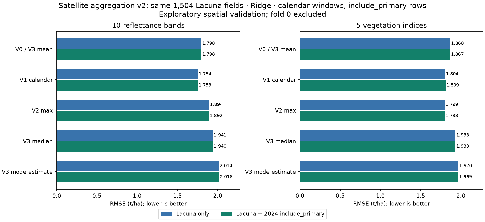

# Satellite aggregation V0–V3 (zimbabwe_aggregation_v2): results

All models use Ridge and the same 1,504 Lacuna 2023 development fields. RMSE is in t/ha (lower is better); R² is pooled out-of-fold (higher is better). Fold 0 was neither fit nor scored. Results are exploratory, not a new blind test.

## Team-rule changes from v1

- **Label-free windows.** No survey date (planting, harvest, crop cut) is a model input or a window anchor. The v1 crop-date window `v1_preharvest_mean` is not a model candidate; V1 is the December 1 – April 1 calendar mean for both sources. `window_audit.csv` keeps crop-date counts only as `diagnostic_` columns that no model or headline uses.
- **Training rows follow `labels_v1.include_primary`.** Merged arms may use 2,456 Zimbabwe 2024 rows (v1: 4,330). The 1,874 removed rows are recorded zeros (`zimbabwe_2024_zero_likely_not_measured`). Lacuna-only arms already used only include_primary rows; their predictions equal v1.
- Unchanged: evaluation fields, outer folds 1–4 of `s1_cc2km`, inner folds, 2 km source buffer, alpha and source-weight grids, seed and 2,000 bootstrap draws.

Primary contrast (10 bands, December–March calendar mean minus full-season mean, Lacuna only): **-0.0445 t/ha**, 95% spatial-group interval **[-0.0805, -0.0086]**.

| Aggregation | Bands: Lacuna RMSE | R² | Bands: merged RMSE | R² | Indices: Lacuna RMSE | R² | Indices: merged RMSE | R² |
|---|---:|---:|---:|---:|---:|---:|---:|---:|
| v0_mean | 1.7984 | 0.1785 | 1.7985 | 0.1785 | 1.8676 | 0.1141 | 1.8671 | 0.1145 |
| v1_calendar_mean | 1.7540 | 0.2186 | 1.7532 | 0.2193 | 1.8037 | 0.1737 | 1.8088 | 0.1690 |
| v2_max | 1.8945 | 0.0884 | 1.8919 | 0.0909 | 1.7986 | 0.1783 | 1.7978 | 0.1790 |
| v3_median | 1.9407 | 0.0434 | 1.9403 | 0.0438 | 1.9332 | 0.0507 | 1.9331 | 0.0508 |
| v3_mode | 2.0143 | -0.0305 | 2.0162 | -0.0325 | 1.9698 | 0.0145 | 1.9692 | 0.0151 |
| index mean + max control (10 features) | — | — | — | — | 1.7968 | 0.1800 | 1.7932 | 0.1833 |

Merged minus Lacuna-only, same predictors (paired RMSE difference and 95% spatial-group interval):

| Predictors | Δ RMSE | Interval | Folds using 2024 |
|---|---:|---|---:|
| bands_v0_mean | +0.0000 | [-0.0009, +0.0010] | 4 of 4 |
| bands_v1_calendar_mean | -0.0008 | [-0.0028, +0.0013] | 4 of 4 |
| bands_v2_max | -0.0026 | [-0.0099, +0.0043] | 4 of 4 |
| bands_v3_median | -0.0004 | [-0.0007, -0.0000] | 1 of 4 |
| bands_v3_mode | +0.0019 | [-0.0055, +0.0114] | 4 of 4 |
| indices_v0_mean | -0.0004 | [-0.0018, +0.0010] | 4 of 4 |
| indices_v1_calendar_mean | +0.0051 | [-0.0023, +0.0136] | 4 of 4 |
| indices_v2_max | -0.0008 | [-0.0017, +0.0001] | 4 of 4 |
| indices_v3_median | -0.0001 | [-0.0015, +0.0011] | 4 of 4 |
| indices_v3_mode | -0.0006 | [-0.0012, -0.0000] | 4 of 4 |
| legacy_indices_mean_max | -0.0036 | [-0.0084, +0.0007] | 4 of 4 |

V0 and V3 mean are identical, so fitted once. Median and mode are separate models. The Lacuna-only index mean+max control reproduces the saved step 9 predictions exactly; its merged twin is refitted on include_primary 2024 rows.

The calendar cutoff includes on/after-harvest scenes for 65 evaluation fields (diagnostic from recorded harvest dates; not a model input).

## Files

- `observations.csv`: candidates with `include_primary`, `label_exclusion_reason` and `training_pool`; crop dates are metadata only.
- `training_rows_audit.csv`: every candidate row and whether it may enter a fit.
- `features.parquet` / `feature_dictionary.json`: label-free predictors only; `window_audit.csv`: counts and `diagnostic_` crop-date columns.
- `target_memberships.csv`, `source_spatial_permissions.csv`: frozen v1 copies; the source table is filtered to include_primary rows at fit time.
- `predictions.csv`, `metrics.csv`, `fold_metrics.csv`, `paired_differences.csv`, `tuning.csv`, `selected_parameters.csv`, `training_outer_diagnostics.csv`.
- `PROTOCOL.md`, `manifest.json`: fixed design, input/output hashes and software versions.
