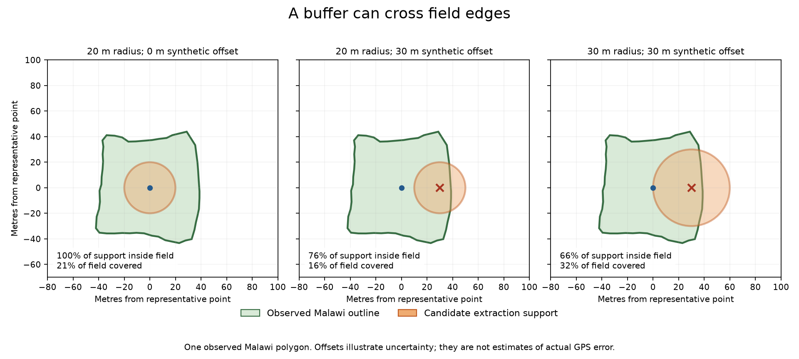

# Source-backed quality review

All original inputs remain unchanged on `felix-branch`. The separate reviewed variant retains every
source observation, preserves yields and coordinates, records uncertain Kenya dates as NULL only in
derived columns, and masks whole field-months under a stricter SCL policy. No models were run.

- Kenya: five invalid planting years and eight ambiguous date-order pairs were quarantined;
  89 genuinely blank harvest dates could not be recovered. Repeated coordinates remain separate
  observations with grouping and source evidence.
- Clouds: all 1,307 frozen scenes / 84,967 field-months checked; 82,381 retained and 2,586 withheld,
  including 1,288 uncertain-classification months. Zero failed scene reads.
- Core observations with at least four retained months: Kenya 3,972; Malawi 206; Lacuna 1,873
  (6,051 total, compared with 6,108 under the original rule). Labels themselves were not dropped.
- Boundaries: same-year FTW lookup found no candidate within 30 m for 203 flagged Kenya records,
  and candidates for only 4 of 260 Malawi polygons. No coordinate or field outline was replaced.

See [the detailed explanation and commands](../../docs/quality/QUALITY_REMEDIATION.md) and
[the aggregate evidence](summary.json). Detailed local outputs and the readable HTML report are in
`data/runs/quality_variant/felix-reviewed-v1/`, with `KEN/`, `MWI/` and `ZWE/` cohort folders.
The SCL/mask cache remains separate under `data/runs/cloud_review/cache/`.

A single observed Malawi field illustrates why a larger extraction support does not establish an
outline or fix a wrong GPS point. The offset is hypothetical. The full geometric experiment uses
260 fields and multiple directions; this illustration is not a field-boundary accuracy estimate.

Validation: 250 data-pipeline tests passed; two Windows-only tests skipped. All 27 protected inputs,
every original label/value/location/group, derivative fingerprints and report links were checked.
The cloud run pins source commit `2d8f2e3`; its separate formatting note preserves exact run-source
hashes. The original Presto/MOSAIKS embeddings have not been rebuilt and are not in this variant.
