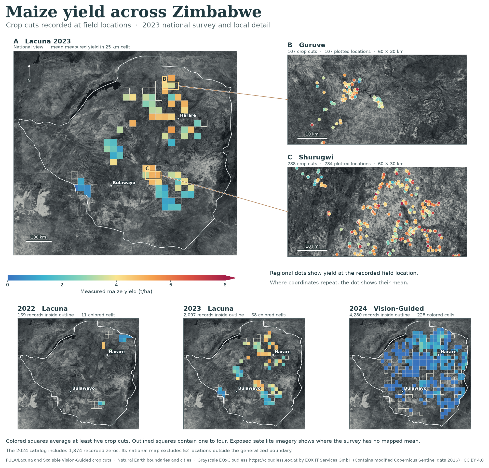

# Zimbabwe maize yield atlas

The notebook opens with measured maize yield, followed by prediction error, seasonal greenness and weather. All four maps use actual Sentinel-2 imagery as their geographic backdrop. Full-resolution figures and captions are available below. [Open the executed notebook](../../notebooks/zimbabwe_visual_atlas.ipynb).

## Map captions

**Measured maize yield, 2022–2024.** The large map shows Lacuna 2023 crop-cut yields in tonnes per hectare. Blue marks lower yield and red marks higher yield. Each colored national grid square averages at least five records within 25 km × 25 km. The boxed regions lead to two close-ups where dots mark measured locations. Guruve contains 107 records at 107 locations and Shurugwi contains 288 records at 284 locations. Repeated coordinates share one mean. The close-ups were selected by sample concentration on either side of 19° S. The three smaller maps use one yield scale to show the change in survey coverage over time. The 2024 catalog includes 1,874 recorded zeros. Of its 4,332 records, 52 fall outside the generalized border. [Open the yield map](yield_map.png) · [Map counts and window selection](map_data_summary.json).

**Measured yield, estimated yield and error.** Each panel uses Lacuna 2023 fields held out during spatial cross-validation of the A1 seasonal-index Ridge model. The first panel gives mean crop-cut yield and the second gives mean predicted yield in the same units. The error panel shows the prediction minus the measurement. Red indicates overprediction and blue indicates underprediction. The colored cells contain 1,444 of the 1,504 development fields. [Open the prediction map](prediction_map.png) · [Prediction data and scores](../../experiments/presto_finetune/runs/zimbabwe_lacuna_2022_2023/).

**Seasonal canopy greenness.** January, February and March 2023 are mapped using identical fields with a clear observation in every month. Yellow-green cells have higher GCVI, indicating greener observed vegetation. The 48 colored cells represent 997 fields. Their median cell means are 2.93, 3.09 and 2.75 in chronological order. The monthly index values come from the Lacuna satellite handoff. [Open the greenness map](greenness_map.png) · [Monthly imagery and provenance](../../data/processed/zimbabwe_midterm_v2/README.md).

**Rainfall and temperature.** January–March rainfall is the percentage of the historical total expected for each NASA POWER cell. Temperature is the departure in °C from the cell's historical mean. The reference period is 1991–2020. Over the same 97 archived cells, median 2024 rainfall reached 62% of normal and median temperature was 1.34 °C above normal. The 2022 and 2023 panels provide the same comparison over earlier harvest seasons. [Open the weather map](weather_map.png) · [Processed weather data](../../data/processed/zimbabwe_weather_v2/README.md).

## Other figures

| Figure | What it shows |
|---|---|
| [Yield distributions](yield_distributions.png) | Cumulative proportions for all screened yields and for the v2 primary-label population, including screened records outside the map outline. |
| [Seasonal greenness by yield group](seasonal_gcvi.png) | Monthly median and interquartile range of observed GCVI in three measured-yield groups. Counts beneath each panel show imagery coverage. |
| [Crop-cut and model agreement](yield_agreement.png) | A1 and frozen Presto predictions on 1,504 held-out fields, followed by means for the same fields in 19 provider administrative units. |
| [Weather and yield correlations](weather_yield_correlations.png) | Correlations across cells with at least five v2 primary records from that harvest. The 2023 panel covers 31 cells and 1,871 fields. The 2024 panel covers 61 cells and 2,435 fields. [Cell means](weather_yield_cell_means.csv). |

## Sources and reproduction

The designs adapt the overview and linked zooms in Fig. 5 and the crop-cut, distribution and correlation comparisons in Jin et al. The grayscale basemap uses the 2016 EOxCloudless mosaic by EOX IT Services GmbH, containing modified Copernicus Sentinel data 2016. The national backdrop and the two regional crops were converted to grayscale and reprojected. The same historical mosaic supplies geographic context across seasons. The boundary and city locations come from Natural Earth. [Jin et al. (2019)](https://doi.org/10.1016/j.rse.2019.04.016) · [EOX Maps](https://maps.eox.at/) · [EOX CC BY 4.0 licence](https://creativecommons.org/licenses/by/4.0/) · [Imagery provenance and checksums](sources/satellite_basemap_provenance.json) · [Boundary and cities](sources/natural_earth_provenance.json).

The [figure inventory](figure_inventory.csv) traces 106 gallery figures to 118 source occurrences. It includes descriptions for maps and related spatial figures. Of the 106, 84 are saved visuals and 22 are reconstructions from committed data. Each contact sheet links to the originals. Enter a gallery ID in the last notebook cell to open the figure at full resolution. [GitHub source snapshot](https://github.com/FelixYu120/DSC-291-Final-Project/tree/8de629aba00ea3cda483fc8f113db38fe8961869).

To rebuild, run the notebook in a Git checkout containing the gallery source revision, using the repository's Python environment. The figure code reads tracked tables and local georeferenced imagery. [Requirements](../../requirements.txt) · [Main map code](../../scripts/paper/atlas_maps.py) · [Greenness map code](../../scripts/paper/atlas_greenness_map.py) · [Basemap reader](../../scripts/paper/atlas_basemap.py).
